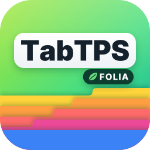

# TabTPS-Folia

A fork of [TabTPS by jpenilla](https://github.com/jpenilla/TabTPS) with **Folia support**.

Shows TPS, MSPT, and other server information in the tab menu, boss bar, and action bar — with **per-region tick data** on Folia servers.

## Platforms

One jar for all of them, requires **Java 17+** and Minecraft **1.20 – 26.3**:

| Server | Tick data | Tested on |
|---|---|---|
| [Folia](https://papermc.io/software/folia) | per region | 1.20.1, 1.20.2, 1.20.4, 1.20.6, 1.21.4, 1.21.5, 1.21.6, 1.21.8, 1.21.11, 26.1.2, 26.2, 26.3 |
| [Canvas](https://canvasmc.io) (Folia fork) | per region | 26.3 |
| [Purpur](https://purpurmc.org) | global | 1.20.1, 1.21.4, 26.3 |
| [Leaf](https://www.leafmc.one) | global | 1.21.4, 26.3 |
| [Spigot](https://www.spigotmc.org) | global | 1.20.1, 1.21.4, 26.3 |

The plugin detects at startup whether the server ticks regions and picks its tick data source accordingly. Spigot has no Paper API, so there the global TPS/MSPT are read directly from the server.

### A note on the build

The plugin compiles against the **oldest** supported API, `folia-api` 1.20.1, and targets Java 17,
so one jar runs on every server from 1.20 to 26.3. Newer Folia internals are only reached through
reflection, and the reflection goes through names that are the same on every version: Bukkit worlds,
`CraftWorld#getHandle` and Folia's own `io.papermc.paper.threadedregions` classes. That matters
because Folia up to 1.20.4 runs with obfuscated Spigot names, and the CraftBukkit package carries a
version suffix there. `com.mojang:brigadier` is a separate compile-only dependency because the
1.20.1 API does not ship it yet.

The plugin shades and relocates its own Adventure 4, because neither `adventure-platform-bukkit`
(4.4.1 is the newest) nor `cloud-minecraft-extras` (2.0.1) has an Adventure 5 release yet, while
Folia moved to Adventure 5 in 26.2. That is why `net.kyori` and `org.slf4j` are excluded from the
`folia-api` dependency: every library that `shadowJar` relocates has to be compiled against the
exact version that gets bundled. Compiling against a 26.2+ API does not work for the same reason,
because `Player` there extends Adventure 5 types such as `ObjectContentsLike`. Revisit this once
`adventure-platform-bukkit` and `cloud-minecraft-extras` ship Adventure 5 builds.

## Features

### Regional TPS/MSPT

On Folia, each player sees the TPS and MSPT of **their current region**, not a global average. When a player moves between regions, the displayed values update automatically.

On servers without regions (Purpur, Leaf, Spigot) there is a single global tick loop, so `tps` and `mspt` show the server-wide values and the region modules below report `N/A`.

### Additional Folia Modules

These modules can be used in display configs:

| Module | Description | Without regions |
|---|---|---|
| `tps` | TPS of the player's current region | global TPS |
| `mspt` | MSPT of the player's current region | global MSPT |
| `lowest_region_tps` | Lowest TPS across all active regions | `N/A` |
| `median_region_tps` | Median TPS across all active regions | `N/A` |
| `highest_region_tps` | Highest TPS across all active regions | `N/A` |
| `ping` | Player ping | same |
| `cpu` | CPU usage | same |
| `memory` | Memory usage | same |
| `players` | Online player count | same |

### Live Information Displays

#### Tab menu
* Command: ``/tabtps toggle tab``
* 

#### Action bar
* Command: ``/tabtps toggle actionbar``
* 

#### Boss bar
* Command: ``/tabtps toggle bossbar``
* 

Configure display modules and themes in `plugins/TabTPS/display-configs/` and `plugins/TabTPS/themes/`.

### Commands

#### Tick Info command
* Command: ``/tickinfo`` or ``/mspt``
* On Folia and Canvas: region TPS overview (Lowest/Median/Highest). Without regions: the standard tick time breakdown
* Permission required: ``tabtps.tps``
* 

#### Memory command
* Command: ``/memory``, `/mem`, or ``/ram``
* Permission required: ``tabtps.tps``
* 

#### Ping command
* Commands: ``/ping``, `/ping [username]`, or ``/pingall``
* Permissions: ``tabtps.ping`` to view your own ping, ``tabtps.ping.others`` to view other users ping.
* 
* 

#### Reload command
* Command: ``/tabtps reload``
* Permission required: ``tabtps.reload``

## Building

```bash
./gradlew :tabtps-folia:shadowJar
```

The built JAR will be at `folia/build/libs/tabtps-folia-*.jar`.

## Credits

- Original [TabTPS](https://github.com/jpenilla/TabTPS) by [jpenilla](https://github.com/jpenilla) (MIT License)
- Folia support by [MCbabel](https://github.com/MCbabel)

## License

[MIT License](license.txt) — Copyright (c) 2020-2024 Jason Penilla, Copyright (c) 2026 MCbabel
